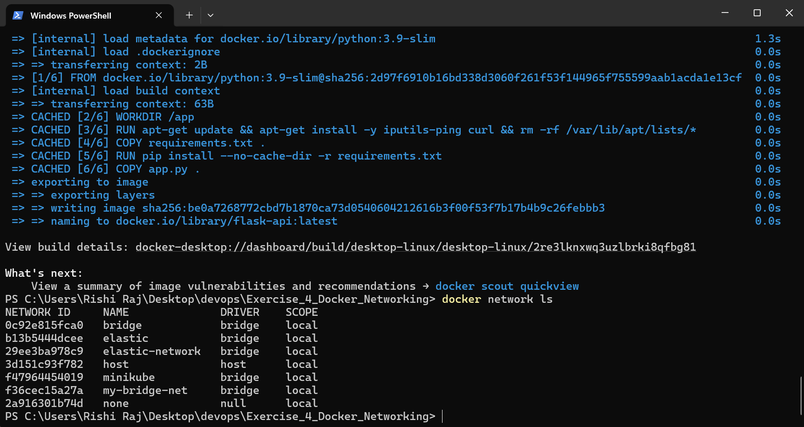
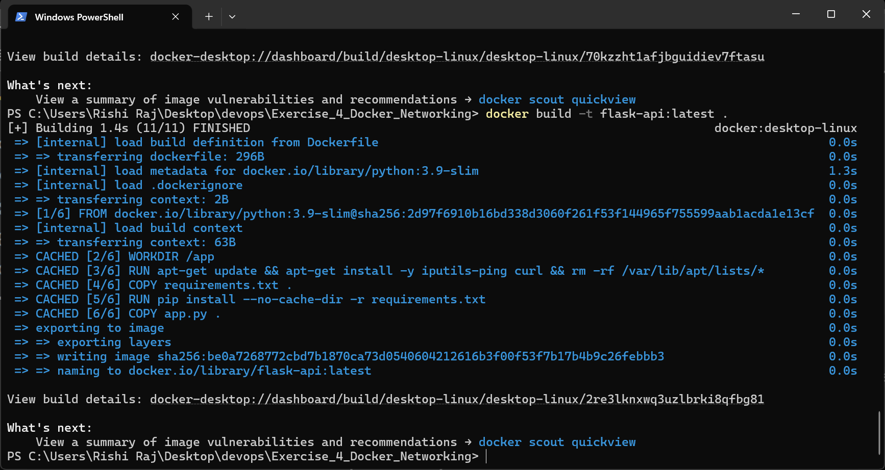
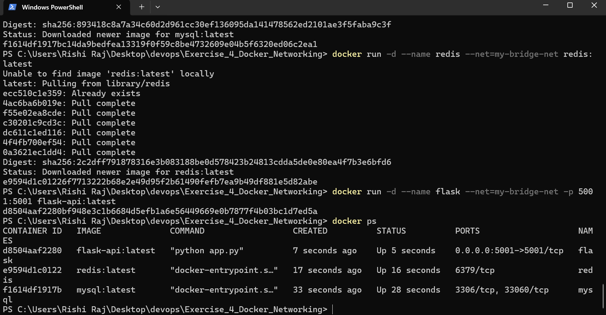
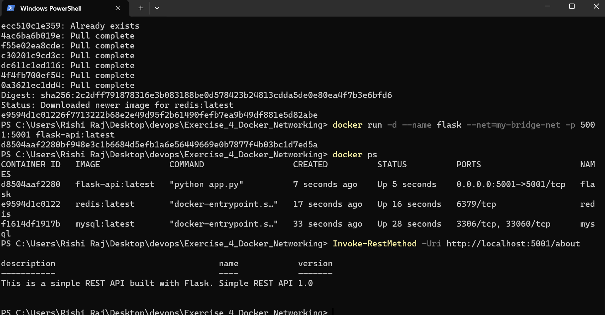
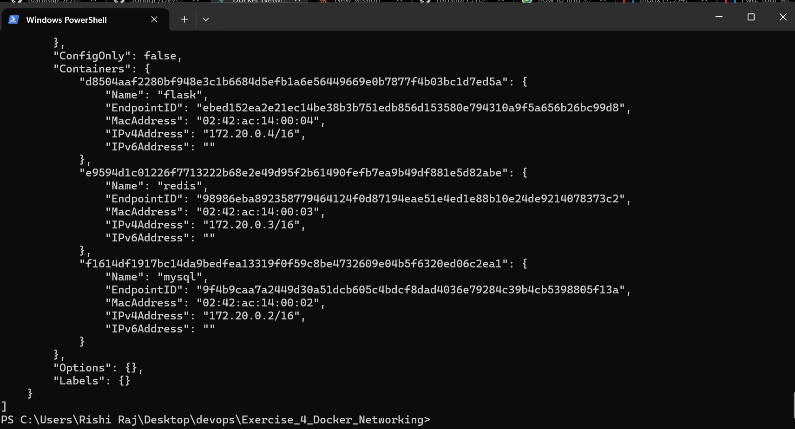
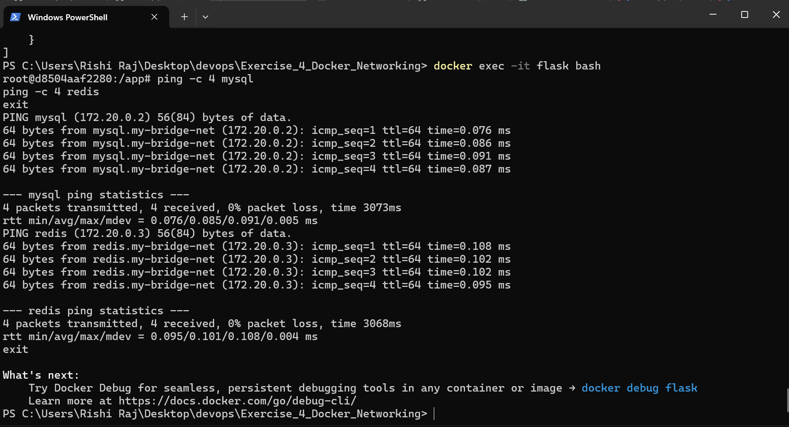
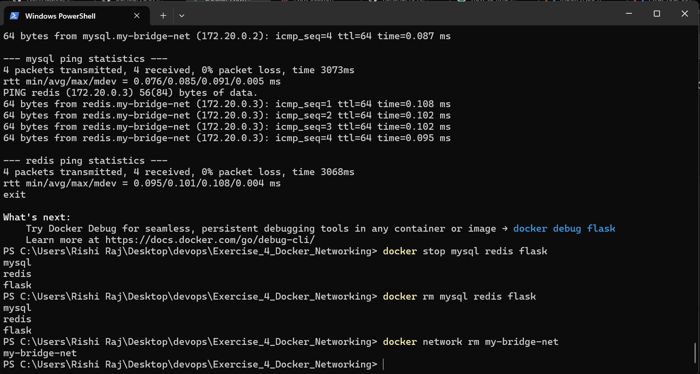

# Exercise 4: Docker Networking with Multiple Containers

## 📌 Objective
Understand fundamental Docker networking concepts and configure isolated inter-container communication across a multi-tier microservice architecture using a custom user-defined bridge network.

---

## 🏗️ Architecture & Scenario
This lab simulates a multi-container application architecture composed of three independent services:
1. **Python Flask Web Server** (`flask-api`): REST service listening on internal port `5001`, exposed to the host machine via `-p 5001:5001`.
2. **MySQL Database** (`mysql:latest`): Database service attached to the private bridge network.
3. **Redis Cache** (`redis:latest`): In-memory cache service attached to the private bridge network.

```text
+-----------------------------------------------------------------------------------+
| Host Machine (Windows 11 / PowerShell)                                            |
|   - Test endpoint: http://localhost:5001/about                                    |
|   - Port Forwarding: 0.0.0.0:5001 -> Container 5001/tcp                           |
+-----------------------------------------------------------------------------------+
                                         │
                                         ▼
+-----------------------------------------------------------------------------------+
| Docker User-Defined Bridge Network: "my-bridge-net" (Subnet: 172.20.0.0/16)       |
|                                                                                   |
|   ┌────────────────────────┐  DNS: "mysql"    ┌────────────────────────┐         |
|   │ Container: flask       │ ───────────────> │ Container: mysql       │         |
|   │ IP: 172.20.0.4         │                  │ IP: 172.20.0.2         │         |
|   │ Port: 5001             │ <─────────────── │ Port: 3306, 33060      │         |
|   └────────────────────────┘                  └────────────────────────┘         |
|                │                                                                  |
|                │ DNS: "redis"                                                     |
|                ▼                                                                  |
|   ┌────────────────────────┐                                                     |
|   │ Container: redis       │                                                     |
|   │ IP: 172.20.0.3         │                                                     |
|   │ Port: 6379             │                                                     |
|   └────────────────────────┘                                                     |
+-----------------------------------------------------------------------------------+
```

---

## 🛠️ Step-by-Step Implementation

### Step 1: Create and Verify the Custom Bridge Network
A user-defined bridge network provides automatic DNS resolution between containers by container name, avoiding reliance on fragile hardcoded IP addresses.

```powershell
docker network create my-bridge-net
docker network ls
```



---

### Step 2: Build the Custom Flask API Container
The Flask service provides an `/about` metadata endpoint. The `Dockerfile` includes network testing utilities (`iputils-ping`, `curl`) to enable connectivity validation from within the container.

```powershell
docker build -t flask-api:latest .
```



---

### Step 3: Deploy Multi-Container Application on `my-bridge-net`
All three containers are instantiated and attached directly to `my-bridge-net` using the `--net` parameter.

```powershell
# 1. Start MySQL database
docker run -d --name mysql --net=my-bridge-net -e MYSQL_ROOT_PASSWORD=rootpass mysql:latest

# 2. Start Redis cache
docker run -d --name redis --net=my-bridge-net redis:latest

# 3. Start Flask API with port binding
docker run -d --name flask --net=my-bridge-net -p 5001:5001 flask-api:latest

# Verify active status
docker ps
```



---

### Step 4: Verify Host-to-Container Connectivity (Port Forwarding)
The `-p 5001:5001` flag maps host port `5001` to internal container port `5001`. Querying the endpoint from the host validates external access.

```powershell
Invoke-RestMethod -Uri http://localhost:5001/about
```

**Output:**
```json
description                                 name             version
-----------                                 ----             -------
This is a simple REST API built with Flask. Simple REST API  1.0
```



---

### Step 5: Inspect Bridge Network IP Allocations
Inspecting `my-bridge-net` reveals internal subnet allocation and IP assignments:
* `mysql`: `172.20.0.2/16`
* `redis`: `172.20.0.3/16`
* `flask`: `172.20.0.4/16`

```powershell
docker network inspect my-bridge-net
```



---

### Step 6: Test Inter-Container Communication & Automatic DNS Resolution
To test service discovery, we enter the `flask` container and ping `mysql` and `redis` by hostname:

```powershell
docker exec -it flask bash
```
```bash
# Inside the container:
ping -c 4 mysql
ping -c 4 redis
exit
```

**Key Results:**
* `ping mysql` resolves automatically to `172.20.0.2` (0% packet loss, avg rtt ~0.085 ms).
* `ping redis` resolves automatically to `172.20.0.3` (0% packet loss, avg rtt ~0.101 ms).



---

### Step 7: Environment Teardown & Resource Cleanup
Cleaning up stops active containers, removes their state, and deletes the custom bridge network:

```powershell
docker stop mysql redis flask
docker rm mysql redis flask
docker network rm my-bridge-net
```



---

## ❓ Lab Review Questions & Answers

### 1. What is the purpose of the `--net` flag in `docker run`?
The `--net` (or `--network`) flag specifies the network to which the container should be attached upon launch. Placing multiple containers on the same user-defined network allows them to communicate with one another using isolated, internal IP addresses and automatic DNS resolution.

### 2. How do containers communicate with each other on the same user-defined network?
Containers communicate using their **container names as hostnames** or via their assigned private IP addresses. Docker's embedded DNS server (listening at `127.0.0.11` within containers) automatically intercepts name queries and resolves container names to their private bridge IPs.

### 3. What is the difference between a bridge network and a host network?
* **Bridge Network:** Creates an isolated virtual software bridge on the host with its own private subnet. Containers receive distinct private IP addresses and communicate through virtual interfaces. Isolation is preserved.
* **Host Network:** Disables network namespace isolation entirely. The container shares the host's network stack directly; container ports bind directly to host network interfaces with zero NAT overhead.

### 4. How can you expose a container's port to the host machine?
Using the `-p` (or `--publish`) flag with the syntax `-p <host_port>:<container_port>` (for example, `-p 5001:5001`). This instructs Docker proxy / iptables rules to route traffic arriving on the specified host port directly to the target port inside the container.
